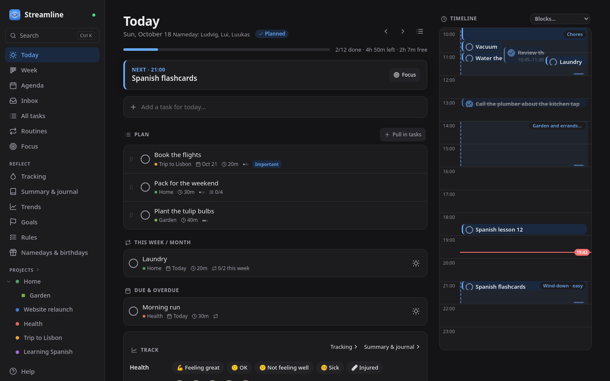
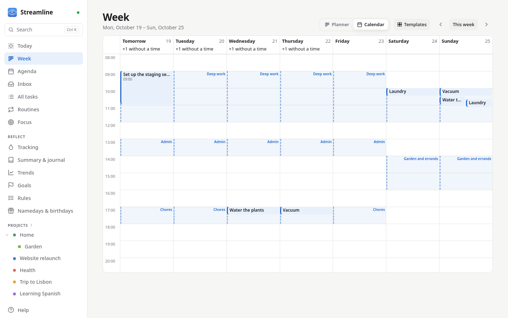
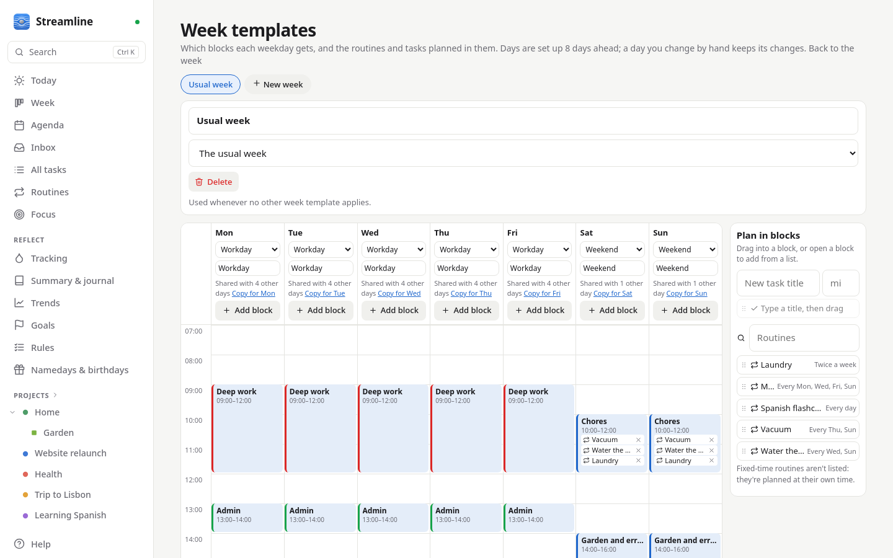
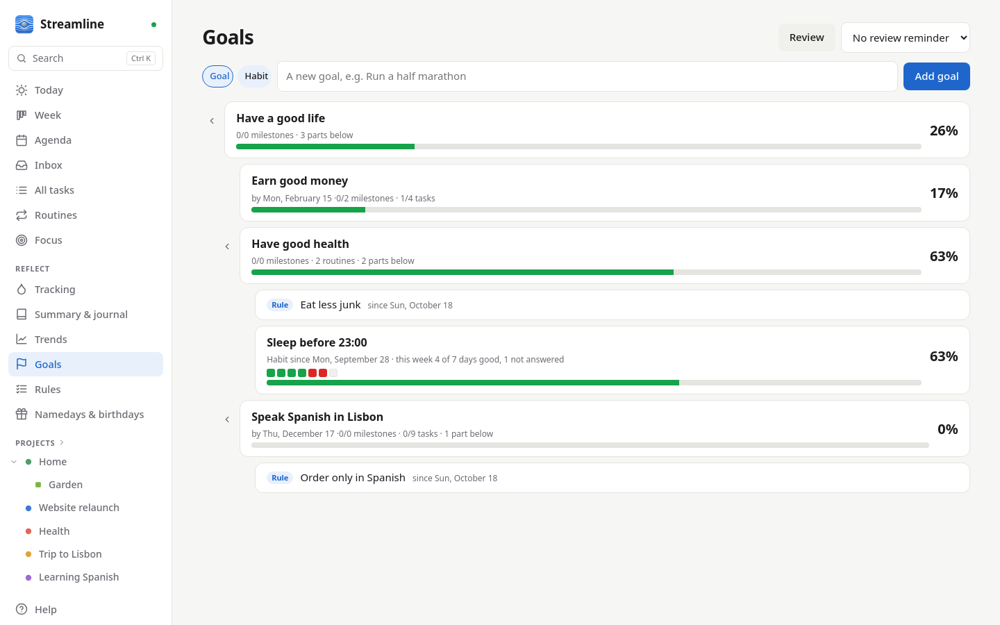
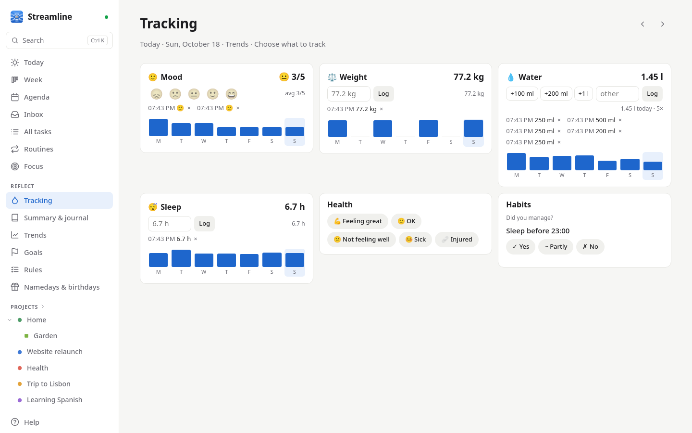
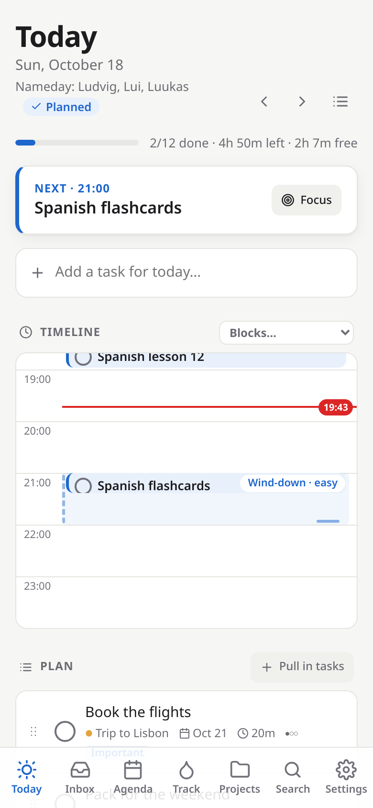
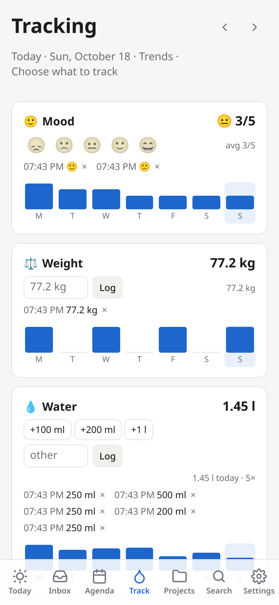

# Features

Everything below is in the app today. *Help* inside the app explains each one step by step.

## Your day

- **Today view** (the landing page): a timeline with a "now" line, an ordered plan, what's up
  next, due and overdue tasks, progress, and browsing other days.
- **Daily planning ritual**: a five-step planner (review → look ahead → pick → arrange →
  confirm) for tomorrow in the evening or today in the morning, with planned vs. free time, an
  overbooking warning, a reminder at your planning time and a banner until the day is planned.
- **Pull tasks into a day** from the ready stack, give them a time and duration, or move them
  to another day.
- **Week view**: a planner with a column per day and each day's load, or the week on an hour
  grid with events, timed tasks and time blocks; drag tasks between days and times.
- **Time blocks and week templates**: day templates with themed blocks (deep work, admin,
  chores…) that can hold routines and one-off tasks, planned into the block on each day;
  several week templates (usual, alternating, for dates), edited on an hour grid and
  previewed on the Week page; overlap warnings with quick fixes; an explainable "suggest
  times" in the planner.
- **End of day by task type**: *Carry on* tasks roll over to the next day (with a "carried N
  days" badge), *Expires* tasks are marked missed. The day ends at a time you choose (default
  04:00).
- **Focus timer**: a distraction-free view of one task with a Pomodoro timer (25/5/15 by
  default) that runs on the server, so it's the same on every device; focus time is added to
  the task.
- **Realistic estimates**: learned from the focus time on finished tasks; the task sheet
  suggests a better estimate when yours are usually off, and planning can count with them.
- **Morning digest**: one message each morning (push, ntfy or in the app) with the plan, fixed
  times, what's due and what to check on.
- **Print the day**: an A4 sheet with tick boxes and a QR code; scan it later to tick off what
  was done on paper.

## Tasks and projects

- **Projects, subprojects (any depth) and an inbox**; a task can also be listed in several
  projects. Complete with undo, archive, and keep not-yet-started projects as quiet *ideas*.
  Every project gets its own colour and shape.
- **Quick-add**: type a task's steps while adding it, or add it as already done, as waiting for
  results, or as ongoing. Default tasks are suggested as you type, checklist included.
- **Forgot to tick it off?** Change when a task was done in its sheet, drag it to the right day
  on the Week planner, or tick it on that day's page.
- **Process the inbox** one item at a time, with one key per decision.
- **Search and keyboard shortcuts**: <kbd>Ctrl</kbd>+<kbd>K</kbd> (or <kbd>/</kbd>) finds tasks,
  projects, routines and pages and acts on a task; single-key shortcuts for the common
  actions (<kbd>?</kbd> lists them).
- **Task details**: notes, due date, estimate, difficulty, importance and urgency, place and
  task type; checklists whose last tick completes the task.
- **Views**: lists, a board (columns by status, project, difficulty or type) or an
  urgent/important matrix; drag cards to change them. Each place remembers its view.
- **Drag and drop** with mouse, touch (long-press) or keyboard: reorder, move to projects,
  schedule on the timeline, resize and unschedule.
- **Waiting for results**: park a task whose work is handed off (a training run, a reply) with
  a check-back time; it asks for nothing meanwhile, then reminds you.
- **Ongoing tasks**: things you keep at over a period (reading a book): shown every day of their
  period, ticked as "worked on it today", counting the days, finished by hand.
- **Places**: give tasks a place (Home, Cottage, Town…); pick where you are, or let GPS detect
  it, and lists show what can be done there.

## Routines and chores

- **Routines**: on a schedule (any iCalendar rule), at a fixed time, or N times a week/month.
  Pick the weekdays straight away. A routine that isn't done is missed; a chore carries on
  until done, as one task that rolls on. Nothing can be ticked off before its day. Each
  occurrence is a normal task; skip or edit one, or change the routine from a date on with
  history kept; streaks per routine.
- **Prerequisites and multi-step chores**: tasks can wait for other tasks (plus an extra wait,
  e.g. while the washing machine runs); chores like laundry (wash → dry → fold) with variants
  per load; only the current step shows as ready.

## Household

- **Groups**: share projects, tasks, routines and goals with a group; anyone can complete a
  shared chore (who did is shown), and changes appear live for everyone. Day plans, focus time,
  journals and logs stay personal.
- **Namedays and birthdays**: a shared nameday calendar (the official Estonian list by
  default); everyone picks their own people and gets tasks like "buy a present" → "wish a happy
  birthday".
- **Sharing with other Streamline servers**: someone with their own Streamline can work on one
  of your projects without an account on yours. See [the guide](guides/sharing.md).
- **Multiple users** (admin-created) and per-device API tokens.

## Calendar and integrations

- **Your calendar**: any CalDAV calendar (Nextcloud, Fastmail, iCloud, Radicale, …). Events
  appear on the timeline and in a week agenda, and busy time is subtracted from your free
  time. Put an event into a project and attach todos to it. Optionally write your timed tasks
  back to a calendar as busy time.
- **GitHub, GitLab and Gitea/Forgejo**: issues and pull requests assigned to you, review
  requests and mentions arrive as tasks and complete themselves when closed or merged.

More in [Integrations](guides/integrations.md).

## Reflect and grow

- **Summary, journal and tracking**: a day summary (planned vs. done, routines, events,
  focus), a private journal with prompts, a daily health check-in, trend charts, CSV
  import/export and a full JSON export.
- **Tracking page**: mood, weight, water (+100 ml, +200 ml, +1 l taps that add up) and your own
  metrics, each with an emoji, quick amounts and an optional reminder; choose and order them
  in Settings.
- **Activity log**: every day records what happened, in time order.
- **Long-term goals**: a tree of goals ("have a good life" → "have good health"), with
  milestones, linked projects, tasks and routines, and progress that fills up from the parts
  below (or set by hand).
- **Habit goals**: things to keep up day by day. Each day you answer yes, partly or no; the
  Goals page shows the week, the streak and the share of good days.
- **Rules**: rules you keep for yourself, like "eat less junk", for good or until a date,
  under any goal and listed in the weekly review.
- **Weekly review**: the week in numbers, loose ends to plan or drop, waiting items, projects
  without a next step, a note (or verdict, for habits) per goal, then the coming week.

## Everywhere

- **Live sync**: changes appear instantly on all your devices.
- **Installable app with notifications** (over HTTPS): add it to your phone's home screen and
  get reminders even when it's closed; read your day offline.
- **Linux desktop app** that keeps working offline, or runs on one computer without a server.
  See [Desktop app](getting-started/desktop.md).
- **Daily automatic backups** and a versioned JSON [API](api.md).
- **Built-in help** and a guided tour on first sign-in.

## Screenshots

The screenshots show made-up example data.

<figure markdown>

<figcaption>Today: the plan, what's due, and the timeline with time blocks</figcaption>
</figure>

<figure markdown>

<figcaption>The dark theme</figcaption>
</figure>

<figure markdown>

<figcaption>Week: blocks and the routines planned into them</figcaption>
</figure>

<figure markdown>

<figcaption>Week templates: draw blocks, drag routines in</figcaption>
</figure>

<figure markdown>

<figcaption>Goals: a tree, with routines, habits and rules</figcaption>
</figure>

<figure markdown>

<figcaption>Tracking: quick amounts and a 7-day strip</figcaption>
</figure>

<figure markdown>
{ width="300" }
<figcaption>Today on a phone</figcaption>
</figure>

<figure markdown>
{ width="300" }
<figcaption>Tracking on a phone</figcaption>
</figure>

