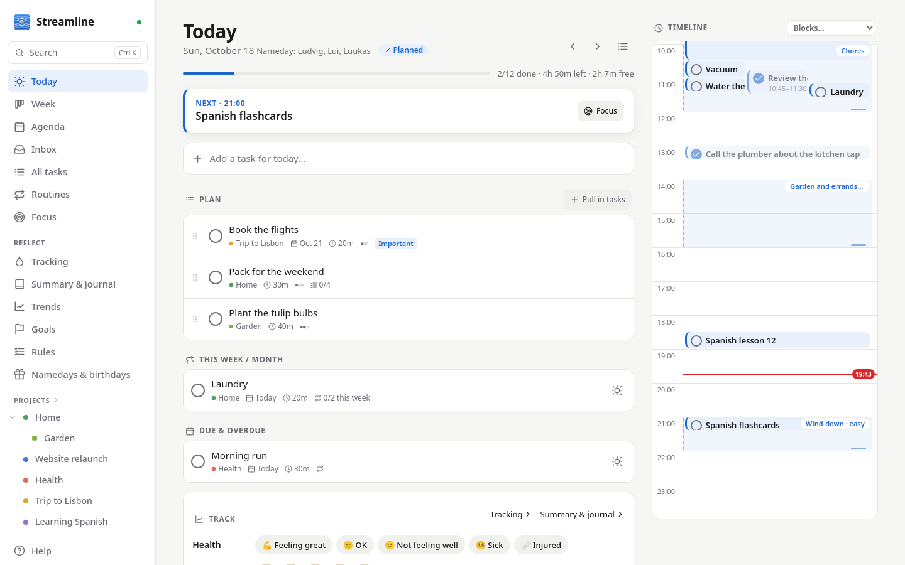

# Streamline

A self-hosted todo list and day planner for a household. One small container, one data
folder, and it works from any phone, tablet or computer on your network, plus a Linux
desktop app that also works offline.

More screenshots are on the [Features](features.md#screenshots) page.

-   :material-sun-clock: **Plan your day**

    A Today view with a timeline, an ordered plan and what's next; a five-step planning
    ritual; time blocks and suggested times around your calendar.

-   :material-account-group: **Share the household**

    Groups share projects, chores and routines; anyone can tick off a shared chore, and
    changes appear live on every device. Day plans and journals stay personal.

-   :material-repeat: **Routines and chores**

    Repeating tasks on any schedule, multi-step chores (wash → dry → fold), checklists,
    prerequisites, waiting for results and ongoing tasks.

-   :material-flag-checkered: **Reflect and keep habits**

    Journal, mood and custom metrics, long-term goals, habit goals answered day by day,
    and a weekly review.

-   :material-calendar-sync: **Connect what you use**

    Any CalDAV calendar (read, and optionally write your plan back), tasks from GitHub,
    GitLab and Gitea, and projects shared with people on other Streamline servers.

-   :material-feather: **Small and private**

    A 16 MB image using about 9 MB of memory; your data stays in one SQLite file on your
    own machine.

## Get going

1. [Install it](getting-started/install.md) with Docker (or the [desktop app](getting-started/desktop.md)).
2. Open it, create the admin account, and add the people in your household.
3. For the installable phone app and notifications, put it [behind HTTPS](getting-started/https.md).

The app has built-in help (*Help* in the sidebar) that explains every feature in detail;
these pages cover running it. Everything it can do is listed under [Features](features.md).

!!! info "Version 1.5"
    1.5 adds a Tracking page (with water and your own metrics), goals as a tree with routines
    attached, rules for yourself, weekdays and roll-on for chores, no ticking off a routine
    before its day, changing when a task was done, and week templates whose time blocks hold
    your routines and tasks. See the [changelog](changelog.md).
